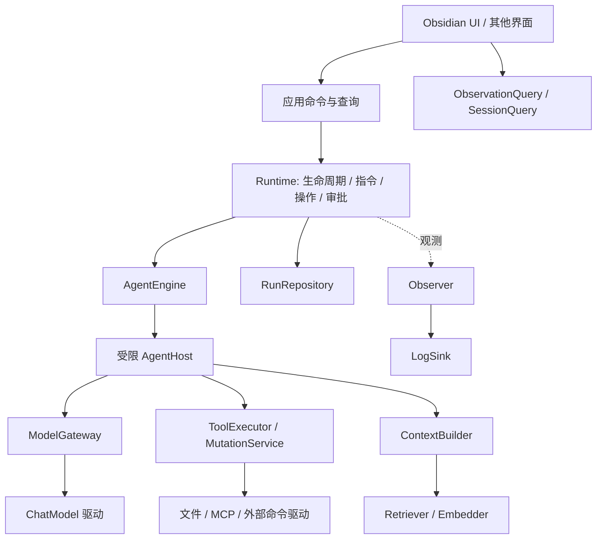

# 可替换模块重构方案

日期：2026-11-13。基线：`b1c43cb`。状态：A 已提交并 push（`9e0df2d`），B1 的接口与依赖组装已实施并完成离线验证；后续目标契约和阶段验收不代表已经实现。两批均未部署至用户 vault。

## 1. 目标与选择

采用模块化单体：一个 Obsidian 插件进程，显式依赖注入，少量稳定端口，多种可替换实现。默认仍使用本地文件、现有模型适配器、现有 Agent 循环和卡片界面。模块可分别替换，不要求拆成服务、npm 包或动态下载插件。

可插拔分三个层次：

1. 策略：上下文选择、压缩、检索、路由、审批规则，通过纯函数或小接口替换。
2. 驱动：模型协议、工具来源、存储、日志出口、界面，通过版本化端口替换。
3. 引擎：Agent 循环与第三方 Agent SDK，通过受宿主约束的 Engine 接口替换。

不是每个类都做插件。解析器、工具配对检查、ID、状态校验等内部细节继续使用普通模块。只有确实存在变化轴的边界才提供替换接口。

任何新实现都必须保持：指令接收持久化、审批有效、已完成操作不重放、未知结果不自动重试、日志失败不改变业务结果、界面不拥有执行状态。替换机制可扩展，这些规则由宿主统一保障，扩展不得旁路。

## 2. 当前问题及目标归属

| 当前问题 | 架构根因 | 目标所有者 |
| --- | --- | --- |
| 超时后核对未执行再重试，晚结果导致重复写 | Controller 的 active 与 Executor 的实际在途操作不一致 | Runtime 中的操作执行监督器 |
| 补充指令接受后丢失 | 接收确认早于持久化，终态未检查待处理输入 | Runtime 指令收件箱 |
| 批量 YAML 损坏、范围误匹配、失败报成功 | 技能自行定义写入和结果规则 | MutationService + 结果契约 |
| 自定义技能审批 metadata 丢失 | 手写 YAML、策略缺失时默认为无需审批 | ManifestReader + Policy |
| 草稿与设置互相覆盖 | 多个入口读改写同一个 data.json | DraftStore 与 SettingsStore |
| 每次恢复重复压缩 | 模型工作上下文只存在内存 | ContextBuilder + checkpoint |
| 重载后部分组件引用旧 registry/provider | 实例创建和生命周期分散 | main 中的唯一组装入口 |
| 两份完整历史可能不一致 | RunStore 与 ChatManager 同时拥有正文 | RunRepository 权威、SessionQuery 投影 |
| 检查器全量扫描、报告口径不一致 | 查询投影散落在展示层 | ObservationQuery |
| 核心通过 getPlugin 获取所有依赖 | adapter 是穿透入口 | 按用途注入小端口 |

## 3. 依赖与目录



依赖方向按调用能力划分；Engine 只获得 AgentHost，不获得 Runtime、插件实例或任意宿主对象。main 负责创建和连接所有实现。基础契约不能 import main、Obsidian、模型 SDK 或 UI。

逐步形成下面的逻辑目录，不先大规模移动文件：

```text
contracts/          跨实现的数据与端口，按领域分文件
application/        用户命令、查询、模块组装
runtime/            运行规则、操作监督、指令及恢复
agents/             默认引擎及其他引擎适配器
providers/          ChatModel / Embedder 的协议驱动
context/            上下文构建、摘要、检索策略
skills/             工具目录、解析、执行、变更服务
storage/            运行 / 草稿 / 设置的默认文件实现
observability/      写入、查询、投影与出口
ui/                 View、Presenter、CardList、输入组件
adapters/obsidian/  宿主文件、命令、设置和界面集成
```

## 4. 可替换边界

| 边界 | 最小契约 | 默认实现 / 可替换方向 | 不能交给该模块的责任 |
| --- | --- | --- | --- |
| Agent 引擎 | AgentEngine + AgentHost | BaseAgent / 新循环或 SDK 适配 | 自行批准、直接写文件、决定运行终态 |
| 聊天模型 | ChatModel.stream(request) | OpenAI-compatible、Anthropic、Ollama | 运行恢复、工具执行 |
| 向量模型 | Embedder.embed(batch) | 现有 embedding / 其他服务 | 聊天路由、业务索引有效性 |
| 上下文 | ContextBuilder.build(input) | 当前摘要和最近消息 / 新记忆策略 | 删除原始历史、改变操作 ID |
| 检索 | Retriever.search(query) | 当前索引 / 关键词、混合检索 | 修改会话、绕过来源标识 |
| 工具来源 | ToolCatalog.list/resolve | 内置、MCP、文档、自定义 | 自己定义审批或执行生命周期 |
| 工具调用 | ToolHandler.invoke | 当前技能实现 / 其他工具驱动 | 私自把 unknown 认定为成功 |
| 文件变更 | MutationService.prepare/apply/verify | Obsidian 文件驱动 | 修改审批过的目标集合 |
| 运行存储 | RunRepository.load/commit/query | 本地文件 / 后续数据库 | 推断业务成功、重放未知操作 |
| 配置与草稿 | SettingsStore / DraftStore | 分文件串行存储 | 控制 Agent、写入聊天正文 |
| 日志 | Observer / LogSink / ObservationQuery | JSONL / 其他出口与查询实现 | 成为执行恢复的事实来源 |
| 界面 | RunCommands + RunQueries + ChatViewState | 当前卡片 / 其他宿主界面 | 直接修改 RunRecord 或 data.json |

接口按需要拆分，不设计一个包含所有可选方法的万能 Module 或 ServiceLocator。配置用实现 ID 选择，业务代码不写 provider/engine 类型 switch。

## 5. 引擎与模型契约

以下是设计草案，实施时通过默认实现和第二个测试实现共同收敛，不一次发布通用 SDK。

```ts
interface AgentEngine {
  readonly descriptor: EngineDescriptor;
  run(input: EngineInput, host: AgentHost): Promise<EngineResult>;
}
interface AgentHost {
  readonly signal: AbortSignal;
  model(request: ModelRequest): Promise<ModelResponse>;
  invoke(call: ToolCall): Promise<ToolOutcome>;
  checkpoint(state: EngineCheckpoint): Promise<void>;
  takeInstructions(): Promise<QueuedInstruction[]>;
  progress(event: EngineProgress): void;
}
```

- EngineInput 只含任务、工作上下文、预算和兼容检查点；所有工具请求走 host.invoke。
- EngineResult 表示本段推理结束。Runtime 检查持久化、交互、未消费指令和实际在途操作后，决定 RunStatus。
- 现有 RunSuspended/RunBlocked 在兼容适配阶段原样传播，不能被 SDK 适配器吞成普通工具失败。
- 第三方 SDK 若只能直接执行宿主工具而不能接入 AgentHost，标为外部执行引擎，其内部副作用不具备本地账本保障，不假装能无损恢复。

ChatModel 的请求采用统一消息、JSON Schema 工具定义、预算和取消信号。适配器负责工具命名、协议格式和结束标识的转换。流事件使用 text_delta、progress、tool_call_delta、terminal 等判别类型；只有完整 terminal 后的完整调用才可执行。

能力声明至少区分工具调用、用量、流式进度、取消、供应商状态续接。缺少必要能力时在启动前拒绝或明确选择兼容模式，不静默降级。

供应商私有状态使用 `{ adapterId, codecVersion, configFingerprint, payload }` 信封；payload 由对应适配器解释，核心不直接认识 reasoningContent。模型绑定包括 provider 实例 ID、model、协议适配器版本和非敏感配置指纹，不包含密钥。认证凭据轮换与语义配置变更分别判断。

## 6. 执行、授权与副作用

复用 RunStatus 和操作账本，不增加一套并行工作流状态机。操作监督器提供实际执行句柄：operationId、generation、settled、result，以及当前取消/等待状态。

1. 幂等查询、审批校验和实际开始在同一个串行执行边界内再检查一次。
2. 等待超时不是副作用失败；停止等待后继续保留句柄和写屏障，记录 unknown。
3. 同进程实际句柄未 settle，不允许“未执行”核对启动第二次调用。
4. 晚结果按 operationId 和 generation 归属，只能更新对应代次，不能覆盖更新的恢复决定。
5. 进程退出后无法保留句柄，依据持久账本按未知处理，先核对外部证据再决定重试。
6. ID 来自持久模型决策和作用域；不以工具名加参数哈希替代操作身份，避免误吞用户有意重复的操作。

工具结果采用判别联合：success、partial、failure、unknown。超时、拒绝、取消是原因/控制事实，不自动证明副作用不存在。批量结果附每文件结果；失败聚合由执行器统一映射。模型回复“完成”不能替代产物验证。账本的去重保证绑定持久 operation 身份；新引擎生成新 ID 的语义等价调用不能被自动识别，切换引擎时须明确交接已完成/未知操作和新 attempt 边界。

MutationPlan 包含明确目标路径、原版本/哈希、预期变更、验证器和计划摘要。审批绑定计划 ID/摘要和目标版本；按文件夹/标签选择的工具先冻结目标集合，不在批准后重新扩大集合。执行前重查版本，逐文件执行并回读，支持部分成功；不会宣称跨进程多文件事务。

技能 manifest 使用标准 YAML 解析和 schema 校验，声明损坏时拒绝加载。旧 custom 技能策略不明时需显式授权。Policy 首先作为宿主内部策略模块；可替换为更严格或其他授权交互实现，但不能降低宿主固定的最低授权约束。宿主执行前仍要验证有效授权和计划一致性。

同进程能力接口帮助解耦，不是安全沙箱；已加载 JS 仍可能访问进程能力。run_command 明确为宿主命令执行，需要授权。真正隔离属于独立外部执行驱动，必须声明文件/网络/进程边界和验证能力。首批不实现通用沙箱，也不靠扩大命令黑名单宣称隔离。

## 7. 数据、指令与上下文

运行快照是运行事实的权威。新运行逐步保存本运行消息增量和基线引用；旧格式完整 messages 由兼容 reader 读取，不原地删除。SessionQuery 从运行链投影会话，索引可重建；ChatManager 暂作兼容投影，停止充当第二份权威正文。迁移期明确读取优先级，禁止两套存储互相回写。

RunRepository.commit(record, expectedRevision) 成功后才能确认操作接收或 checkpoint 成功。默认文件实现采用单写入队列、版本检查、宿主支持的安全替换和备份；能力不满足时声明局限，不以同进程队列冒充跨设备事务。检测外部文件修改应拒绝旧版本覆盖；首期不支持两个设备同时执行同一运行。

用户补充指令以独立 ID 持久记录 queued/consumed 状态，接收落盘后 UI 才清空。完成、暂停和轮次耗尽前检查剩余队列：处理、保留到恢复，或明确交还用户，不能静默丢弃。消费动作随对应上下文 checkpoint 提交，恢复时不重复注入。

ContextSnapshot 包含摘要、保留消息/工具完整单元、源历史版本、策略 ID/版本和 token 估算。摘要成功后进入 checkpoint；恢复复用，只有来源或策略不兼容才重建。预算统一包含系统提示、上下文、工具 schema、供应商状态、输出预留；原始 transcript 保留作审计和新策略投影。

SettingsStore 和 DraftStore 分开保存，新写入不再共同覆盖 data.json。旧 drafts 采用可重复迁移：先复制并核对，再记录迁移标记；回滚版本前保留旧数据备份，避免旧 settings 保存删除新草稿。

## 8. 模块选择、替换和恢复

首期使用静态工厂表，仅 main/composition 访问注册表，不让业务在运行时按字符串查任意服务。manifest 描述 id、kind、实现版本、contract major、能力、checkpoint codec；依赖通过构造函数明确注入。只为确实有资源的模块定义 initialize/dispose，不强迫纯策略实现生命周期。

区分接口版本、实现版本、数据版本，不能用插件版本号代替三者。启动先验证依赖与能力，再开放命令；失败时保留旧实现或禁用对应功能，不能暴露半初始化服务。

| 替换场景 | 行为 |
| --- | --- |
| 主题配色/密度 | 即时更改，不重建运行依赖 |
| UI 实现 | 保存草稿和订阅游标，切换展示；执行继续 |
| 模型/引擎/工具配置 | 新任务采用新绑定；进行中任务保留旧实例 |
| 同引擎兼容 checkpoint | 版本验证后恢复原任务 |
| 引擎或状态 codec 不兼容 | 无在途、unknown、待审批时，显式从已提交历史创建新 attempt 或后继运行 |
| 有待审批/未知副作用 | 先完成核对或取消；更换模块不能跳过 |
| 存储后端 | 独占维护窗口，复制、schema/hash/数量核对、切换；失败保留旧源 |
| 第三方模块缺失 | 历史仍可读；需要其私有状态的任务提示不可恢复，不自动用其他模块重放 |

切换流程：构建候选 → 契约/能力检查 → 在安全边界绑定 → 旧实例引用归零后释放。需要断开旧进程才能启动的新驱动，显式维护窗口，不承诺任意热替换。

卸载：停止接收新命令 → 保存待处理输入 → 请求停止运行并检查实际在途工具 → 保存中断状态 → 关闭 transport → 刷日志 → 释放监听/UI。无法协作取消的工具不伪称已停止，持久保留 unknown。

## 9. UI 与观测

保留现有 ChatPresenter、CardList。View 只调用 RunCommands、RunQueries、DraftStore；不直接读取插件完整配置/操作存储。输入组件通过文本、焦点、选区、提交事件与布局交互，逐步收缩 DOM 暴露面；主题尽量变为配置。

Observer 负责无异常传播的规范化记录；LogSink 负责写入/排空；ObservationQuery 负责过滤、游标分页和共享统计。检查器和报告复用查询/投影，旧格式只留兼容 reader。先按 run/时间筛选再投影详情；实时增量合并、搜索防抖。业务快照仍独立于日志，日志被轮转不会导致运行无法恢复。

## 10. 实施计划与退出标准

每批均保持可构建、可测试和旧数据可读。先修已复现缺陷，再替换内部结构；不能以“接口已经定义”代替模块替换验收。

| 批次 | 具体范围 | 验收 / 退出标准 |
| --- | --- | --- |
| A：可靠性基线，当前启动 | 实际在途与重试竞态；指令消费边界；批量 YAML/目标/结果；manifest 审批解析；草稿独立写入 | 现有竞态复现转回归；两种晚结果顺序都不重复写；指令不丢；批量不破坏字段/越界；草稿不覆盖配置 |
| B：宿主契约与组装 | 提取无宿主依赖类型；注入小端口；RunCommands/Queries；静态工厂选择；安全重载 | 核心不依赖 main/getPlugin；替换工具目录后 MCP/子 agent 引用一致；进行中实例不被设置改动替换 |
| C：可恢复数据与上下文 | Repository revision/安全写；持久指令收件箱；ContextSnapshot；ChatManager 兼容投影 | 崩溃/落盘失败注入；恢复不重复压缩、不重复指令、不覆盖其他会话；旧快照回归通过 |
| D：统一工具执行边界 | ToolCatalog/Handler；MutationPlan；策略与结果归一化；迁移 batch/move/write/edit | 同一契约测试适用于所有内置写入和 MCP/custom；审批目标变化失效；部分失败可准确呈现 |
| E：可替换模型与引擎 | ChatModel/Embedder 分离；opaque provider state；BaseAgentEngine；第二个测试引擎 | 两个引擎共享审批/恢复/取消测试；两个模型驱动共享终止与工具配对测试；不兼容恢复明确阻止 |
| F：查询和界面收口 | ObservationQuery、增量索引；View 瘦身；运行摘要按需加载 | 2K/20K/100K 事件基准有记录，刷新只处理增量；更换 View 不影响执行与草稿 |

首批 A 已将指令队列持久化并堵住完成/暂停时丢弃队列的窗口，统一原子提交在 C 完成；过渡阶段保留可见草稿/待处理内容，并注明保证范围。其他跨批次能力同样通过兼容适配逐步收口，不宣称首批已完成最终架构。

### 第一批实际实施记录

已实施并完成离线验证，提交 `9e0df2d` 已 push 并核对远端 SHA；本批不包含本地部署。

- Runtime 跟踪实际工具及结果保存的在途 promise；核对入口检查在途，执行屏障内重查已完成操作；会话边界检查移至 mutation 前。
- 指令接收先等待快照保存；轮次边界读取持久队列，transcript 记录 instructionId，checkpoint 后确认消费。最终回复时仍有队列则保留为 interrupted，并在卡片显示未处理内容。主/子任务队列隔离。
- 第一批的 checkpoint 与消费确认是两次保存，通过 ID 对账防止重复注入；尚不是原子事务。接收失败时回滚并补偿保存，但不承诺在所有磁盘错误和崩溃组合下实现原子接收。C 批次统一提交边界后再扩大此保证。
- 草稿抽为可注入 DraftStore，默认独立文件，串行写、备份及回读；旧草稿一次迁移，清除后不再从 legacy 数据复活。迁移验证前保留旧值，成功后下一次设置保存可删除旧字段，回滚依赖备份。
- 草稿迁移故障只隔离草稿持久化：保留旧字段、记录错误并提示，内存 fallback 不谎称写入成功，AI 与设置仍可加载。
- 批量使用宿主 YAML API，修复目录匹配和失败聚合；loader 验证 metadata，自定义执行未声明审批时默认要求确认。
- 批量 YAML 重序列化保留数据语义，可能改变排版并丢失 YAML 注释；尚未接入统一 MutationPlan、计划审批和逐文件写后验证，不能据此声称所有写入风险已解决。
- 仍待后续实施：上下文摘要持久化、运行正文唯一权威迁移、模型/引擎端口及替换验证、统一日志查询、全面移除 getPlugin 穿透。
- 验证：35 个测试文件、304 项离线测试通过（基线 263 项，新增 41 项）；构建包含类型检查、lint、diff 检查通过。覆盖审批暂停、接收落盘失败及未提交指令不可消费、checkpoint/ack 间重启、子任务隔离、两种晚结果顺序、草稿故障降级、YAML 与范围完整性。未运行真实模型、GUI、真实 vault 写入或联网集成测试。

### B1 实际实施记录：接口与依赖组装

B1 是批次 B 的可交付子集；没有宣称整个核心已经去除宿主类型及 getPlugin。

- 新增 `contracts/run-access.ts` 的 RunCommands/RunQueries/RunAccess，以及 `runtime/run-access.ts` 适配器；ChatView 显式注入此端口，不再访问 plugin.runController。旧历史/诊断弹窗继续兼容，后续再迁移。
- 查询返回脱离 controller 的冻结快照，缓存未变化历史；已结束消息复用快照，避免流式刷新反复复制完整会话。契约仍 type-only 复用旧 domain 类型，彻底提取 portable 消息/来源 DTO 留后续。
- ProviderFactory 由 main 显式选择；AIRouter 不再按模型类型分支构造 SDK，按工厂声明判断 embedding 能力。prepare 保留工厂注入，构造候选时不改变旧路由。现有供应商配置 ID、DeepSeek high/65536 保持兼容；尚未拆 ChatModel/Embedder 或开放任意新供应商类型的设置 UI。
- 配置保存串行执行“构造候选路由 → 准备候选聊天图 → 保存配置 → 同步切换”。候选失败保持旧图；持久保存/最终守卫失败会恢复原配置，恢复失败单独告警。这是单实例受控配置提交，不是文件系统/跨设备事务。
- 执行图绑定独立设置快照；权限、审批和 web 凭据不再读取 UI 尚未提交的编辑。存在在途、等待、中断、未知操作时拒绝执行配置切换并明确提示；纯界面配置可以保存且不重建模型图。
- 技能重载与模型刷新更新默认、内置、自定义、委派和临时 agent 的整套 registry/executor/provider。保留 AgentManager 对象身份，所有管理器编排参与活动计数；候选严格验证失败保留旧图，准备阶段不执行冷启动模型请求或创建偏好模板。
- MCP 复用现有连接并把工具注册到候选目录；提交时重绑。MCP 连接配置变化只保存，明确提示重载插件后生效，不宣称已实现进程连接的热替换事务。
- ExtensionManager 通过 getter 读取当前执行图，跟踪 api.registerSkill 声明并复制到候选目录；校验冲突和声明版本，不重跑 factory、不重复订阅，注销技能不会复活。插件卸载时在运行停止后清理扩展技能/订阅。
- 扩展自行缓存旧 registry/executor，或绕过 api.registerSkill 直接改目录，仍属于兼容限制；不能自动迁移这些第三方私有引用。同进程扩展也不是安全隔离边界。
- 新增共享 RunAccess consumer 契约（真实 runtime 与独立内存实现），可注入模型工厂、候选失败/提交顺序/回滚、重载图、扩展声明、已提交策略快照及无 controller 的 ChatView 回归。
- 验证：43 个测试文件、347 项离线测试通过（相对 A 新增 43 项）；构建/类型检查、lint、diff 检查通过。未启动真实模型/MCP进程，也未部署或执行真实 vault 写入及 GUI 验证。
- 下一步：B2 收缩 ChatOrchestrator/SkillContext 的宿主穿透及旧弹窗直接依赖；C 再统一运行仓库提交、历史投影和持久上下文。不会以当前快照接口冒充引擎/存储替换已经完成。

## 11. 契约验证与回滚

- 用共享契约测试验证每个实现，生产默认实现和最小 fake 都执行；不只对接口做类型检查。
- 关键时序：开始前取消、等待超时但工具未结束、晚结果早于/晚于重试、审批后文件变化、提交前磁盘失败、重复回答、切换模块时有未完成操作。
- 迁移样本：旧完整历史、损坏主文件/可读备份、旧 provider 状态、旧技能 manifest、草稿与设置并发更新。逐项核对条数、ID、内容哈希和审批状态。
- 替换验收：只修改组装配置即可更换第二实现，业务调用方不改；缺能力和缺 codec 均有可理解错误。
- 第一批真实宿主验收只做只读/合成任务；文件变更使用隔离 vault，不重放用户历史写入。真实供应商验证另外记录，不用 fake 测试代替。
- 发布前备份插件、配置、运行和旧历史。数据迁移优先复制并验证；停止旧写入者后切换。回滚前先排空/标记在途任务，不把新格式数据直接交给旧实现写回。

## 12. 本轮暂不建设

不引入微服务、远端数据库、通用插件市场、动态依赖解析、全量事件溯源框架、Redux/DI 容器、跨设备分布式锁或任意 JS 安全沙箱。需要这些能力时以明确的新驱动或宿主能力增加，不能为了“可插拔”提前承担所有复杂度。

衡量成功的标准是：更换一个实现时，调用方少改、旧数据可读、运行保证不退化、契约测试可复用；不是接口数量或目录数量增加。
